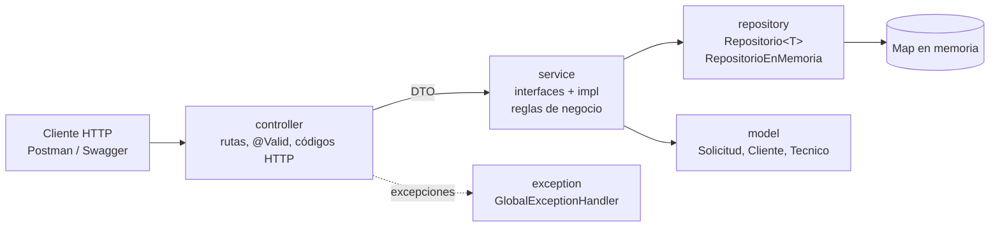
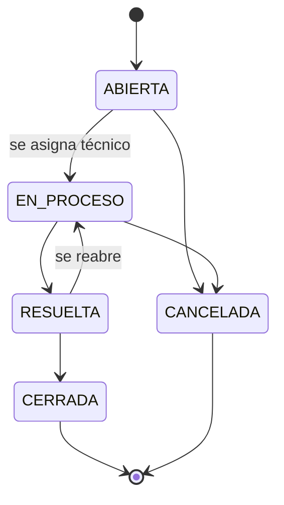

# API de Solicitudes de Soporte Técnico

API RESTful en Java y Spring Boot para que una empresa de servicios tecnológicos registre, consulte, actualice y elimine las solicitudes de soporte técnico de sus clientes, y asigne técnicos para atenderlas.

Proyecto de la evaluación parcial del curso **Desarrollo de los Componentes del Negocio** (IDAT).

## Problema que resuelve

Hoy las solicitudes llegan en papel o por correos desordenados: se pierde información y la atención se retrasa. La API centraliza cada solicitud con su cliente, su prioridad, el técnico asignado y el estado de la atención, y aplica las reglas del negocio para que ninguna solicitud se cierre sin ser atendida ni se pierda el historial.

## Stack

| Componente | Versión |
|---|---|
| Java | 21 |
| Spring Boot (Web, Validation) | 4.1.1 |
| Swagger UI (springdoc-openapi) | 3.1.1 |
| Maven (incluido con `mvnw`) | 3.9 |
| Pruebas | Postman |

Los datos se guardan **en memoria** (en un `Map`), sin base de datos: se pierden al detener la aplicación.

## Arquitectura



```
src/main/java/pe/idat/soporte
├── config/        Swagger y datos de ejemplo
├── controller/    recibe las peticiones y valida con @Valid
├── dto/           datos de entrada y salida (records)
├── exception/     manejo de errores con un formato único
├── mapper/        convierte entidades a DTO
├── model/         Persona, Cliente, Tecnico, Solicitud y enums
├── repository/    guarda los datos en un Map
└── service/       reglas del negocio (interfaces y service/impl)
src/test/java/...  pruebas de modelo, repositorio, servicio y API
postman/           colección de pruebas funcionales
docs/img/          capturas
```

## Cómo ejecutarlo

Requisitos: **JDK 21** e **IntelliJ IDEA**. Maven no hace falta instalarlo: viene incluido en el proyecto.

1. Descargar el repositorio:
   ```bash
   git clone https://github.com/oropezadev-wq/soporte-tecnico-api.git
   ```
   o en GitHub: *Code → Download ZIP*.
2. Abrir la carpeta en IntelliJ IDEA (*File → Open*) y esperar a que termine de cargar las dependencias.
3. Ejecutar la clase `SoporteTecnicoApiApplication` (botón *Run*).

La API queda en `http://localhost:8080` con datos de ejemplo cargados (2 clientes, 2 técnicos y 3 solicitudes).

- API: <http://localhost:8080/api/v1>
- Swagger UI: <http://localhost:8080/swagger-ui.html>


## Endpoints

Base: `/api/v1`

| Método | Ruta | Descripción | Respuestas |
|---|---|---|---|
| POST | `/clientes` | Registrar un cliente | 201, 400, 409 |
| GET | `/clientes` | Listar clientes | 200 |
| GET | `/clientes/{id}` | Obtener un cliente | 200, 404 |
| GET | `/clientes/{id}/solicitudes` | Solicitudes de un cliente | 200, 404 |
| PUT | `/clientes/{id}` | Actualizar un cliente | 200, 400, 404, 409 |
| DELETE | `/clientes/{id}` | Eliminar un cliente sin solicitudes | 204, 404, 409 |
| POST | `/tecnicos` | Registrar un técnico | 201, 400, 409 |
| GET | `/tecnicos?especialidad=REDES` | Listar técnicos (filtro opcional) | 200, 400 |
| GET | `/tecnicos/{id}` | Obtener un técnico | 200, 404 |
| GET | `/tecnicos/{id}/solicitudes` | Solicitudes asignadas a un técnico | 200, 404 |
| PUT | `/tecnicos/{id}` | Actualizar un técnico | 200, 400, 404, 409 |
| DELETE | `/tecnicos/{id}` | Eliminar un técnico sin solicitudes | 204, 404, 409 |
| POST | `/solicitudes` | Registrar una solicitud | 201, 400, 404 |
| GET | `/solicitudes?estado=ABIERTA&prioridad=ALTA` | Listar solicitudes (filtros opcionales) | 200, 400 |
| GET | `/solicitudes/{id}` | Obtener una solicitud | 200, 404 |
| PUT | `/solicitudes/{id}` | Actualizar título, descripción y prioridad | 200, 400, 404, 409 |
| PATCH | `/solicitudes/{id}/tecnico` | Asignar un técnico | 200, 400, 404, 409 |
| PATCH | `/solicitudes/{id}/estado` | Cambiar el estado | 200, 400, 404, 409 |
| DELETE | `/solicitudes/{id}` | Eliminar una solicitud ABIERTA o CANCELADA | 204, 404, 409 |

### Reglas del negocio



- Toda solicitud empieza **ABIERTA** y pasa a **EN_PROCESO** al asignarle un técnico; no se pueden saltar estados.
- Una solicitud CERRADA o CANCELADA ya no se modifica, y solo se eliminan las ABIERTAS o CANCELADAS.
- El email de clientes y técnicos es único, y no se elimina a quien tenga solicitudes.

Los errores responden **400** (datos inválidos), **404** (no existe) o **409** (rompe una regla del negocio).

## Pruebas con Postman

Importar `postman/soporte-tecnico-api.postman_collection.json` en Postman y ejecutarla con el **Runner** con la API levantada. Son 28 peticiones con 48 tests, en orden: cada petición guarda los ids que usan las siguientes.

## Equipo

| Apellidos | Nombres | Rol |
|---|---|---|
| Lopez Marmanillo | Abraham Sebastiam | Capa de presentación: controladores REST, validaciones de entrada y Swagger |
| Oropeza Ávila | Wali | Líder del proyecto y capa de negocio: servicios, reglas y manejo de excepciones |
| Pascual Cárdenas | Rony Emerzon | Capa de datos: modelo, repositorios en memoria y pruebas con Postman |
