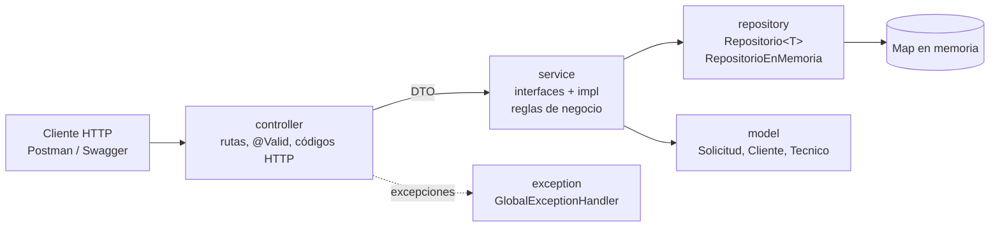
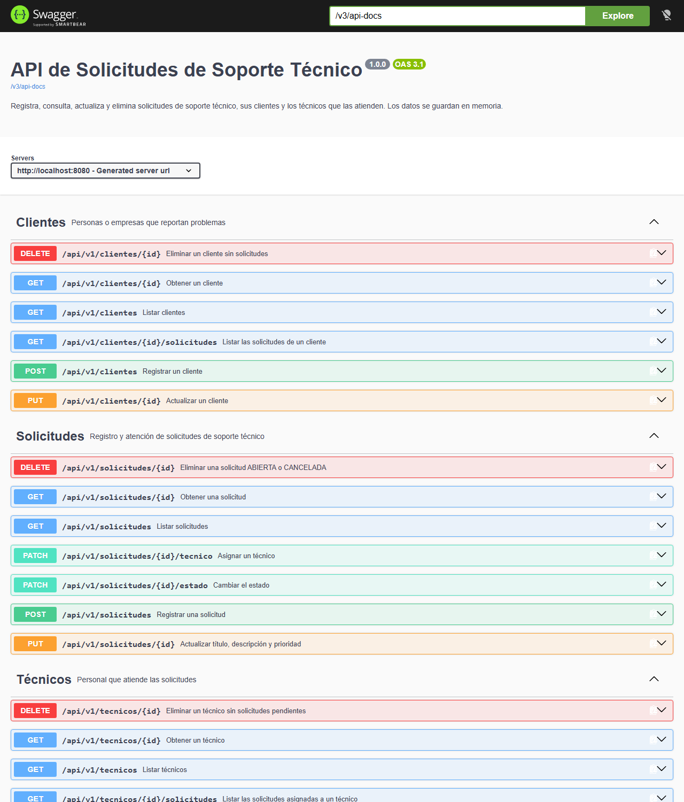
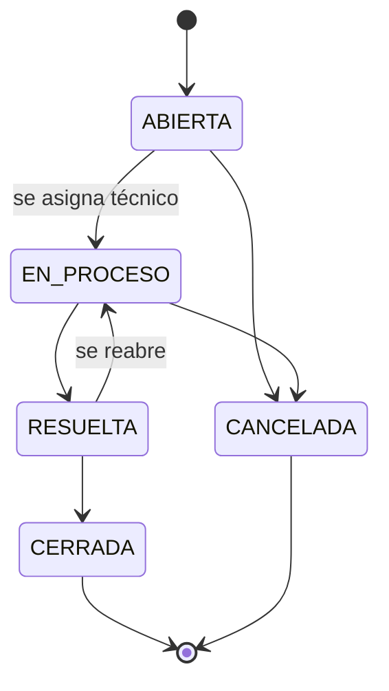

# API de Solicitudes de Soporte Técnico

API RESTful en Java y Spring Boot para que una empresa de servicios tecnológicos registre, consulte, actualice y elimine las solicitudes de soporte técnico de sus clientes, y asigne técnicos para atenderlas.

Proyecto de la evaluación parcial del curso **Desarrollo de los Componentes del Negocio** (IDAT).

## Problema que resuelve

Hoy las solicitudes llegan en papel o por correos desordenados: se pierde información y la atención se retrasa. La API centraliza cada solicitud con su cliente, su prioridad, el técnico asignado y el estado de la atención, y aplica las reglas del negocio para que ninguna solicitud se cierre sin ser atendida ni se pierda el historial.

## Stack

| Componente | Versión |
|---|---|
| Java (Eclipse Temurin) | 21 |
| Spring Boot (Web MVC, Validation) | 4.1.1 |
| springdoc-openapi (Swagger UI) | 3.1.1 |
| Maven (incluido con `mvnw`) | 3.9 |
| Pruebas | JUnit 5, AssertJ, MockMvc, Postman/Newman |

Los datos se guardan **en memoria** (`ConcurrentHashMap`), sin base de datos: se pierden al detener la aplicación.

## Arquitectura



- **controller**: recibe la petición, valida el cuerpo con `@Valid` y devuelve el código HTTP adecuado. No contiene lógica de negocio.
- **dto**: `record` de entrada (`*Request`, con las validaciones) y de salida (`*Response`). Las entidades nunca salen de la capa de servicio.
- **service**: una interfaz por recurso y su implementación en `service/impl`. Aquí viven las reglas del negocio.
- **repository**: la interfaz `Repositorio<T>` define la persistencia. `RepositorioEnMemoria<T>` la implementa con un `Map` e ids autoincrementales, y cada repositorio concreto añade sus consultas (por email, por estado, etc.). Para usar una base de datos real se cambia solo esta capa.
- **model**: entidades con atributos privados. `Persona` es abstracta y la heredan `Cliente` y `Tecnico`. `Solicitud` controla su propio ciclo de vida.
- **exception**: `@RestControllerAdvice` que convierte cada excepción en una respuesta con el mismo formato.

```
src/main/java/pe/idat/soporte
├── config/        OpenApiConfig (Swagger) y DatosIniciales (datos de ejemplo)
├── controller/    ClienteController, TecnicoController, SolicitudController
├── dto/           *Request, *Response, ErrorResponse
├── exception/     GlobalExceptionHandler y excepciones del negocio
├── mapper/        SoporteMapper (entidad ↔ DTO)
├── model/         Persona, Cliente, Tecnico, Solicitud y enums
├── repository/    Repositorio, RepositorioEnMemoria y repositorios concretos
└── service/       interfaces y service/impl
src/test/java/...  pruebas de modelo, repositorio, servicio y API
postman/           colección de pruebas funcionales
docs/img/          capturas
```

## Cómo ejecutarlo

Requisito: **JDK 21**. Maven no hace falta: el proyecto trae `mvnw`.

```bash
git clone <url-del-repositorio>
cd soporte-tecnico-api

# Windows
mvnw.cmd spring-boot:run
# Linux / macOS
./mvnw spring-boot:run
```

La API queda en `http://localhost:8080` con datos de ejemplo cargados (2 clientes, 2 técnicos y 3 solicitudes).

- Swagger UI: <http://localhost:8080/swagger-ui.html>
- Especificación OpenAPI: <http://localhost:8080/v3/api-docs>

En IntelliJ IDEA: *File → Open* sobre la carpeta, esperar a que Maven descargue las dependencias y ejecutar `SoporteTecnicoApiApplication`.



## Endpoints

Base: `/api/v1`

| Método | Ruta | Descripción | Respuestas |
|---|---|---|---|
| POST | `/clientes` | Registrar un cliente | 201, 400, 409 |
| GET | `/clientes` | Listar clientes | 200 |
| GET | `/clientes/{id}` | Obtener un cliente | 200, 404 |
| GET | `/clientes/{id}/solicitudes` | Solicitudes de un cliente | 200, 404 |
| PUT | `/clientes/{id}` | Actualizar un cliente | 200, 400, 404, 409 |
| DELETE | `/clientes/{id}` | Eliminar un cliente sin solicitudes | 204, 404, 409 |
| POST | `/tecnicos` | Registrar un técnico | 201, 400, 409 |
| GET | `/tecnicos?especialidad=REDES` | Listar técnicos (filtro opcional) | 200, 400 |
| GET | `/tecnicos/{id}` | Obtener un técnico | 200, 404 |
| GET | `/tecnicos/{id}/solicitudes` | Solicitudes asignadas a un técnico | 200, 404 |
| PUT | `/tecnicos/{id}` | Actualizar un técnico | 200, 400, 404, 409 |
| DELETE | `/tecnicos/{id}` | Eliminar un técnico sin solicitudes pendientes | 204, 404, 409 |
| POST | `/solicitudes` | Registrar una solicitud | 201, 400, 404 |
| GET | `/solicitudes?estado=ABIERTA&prioridad=ALTA` | Listar solicitudes (filtros opcionales) | 200, 400 |
| GET | `/solicitudes/{id}` | Obtener una solicitud | 200, 404 |
| PUT | `/solicitudes/{id}` | Actualizar título, descripción y prioridad | 200, 400, 404, 409 |
| PATCH | `/solicitudes/{id}/tecnico` | Asignar un técnico | 200, 400, 404, 409 |
| PATCH | `/solicitudes/{id}/estado` | Cambiar el estado | 200, 400, 404, 409 |
| DELETE | `/solicitudes/{id}` | Eliminar una solicitud ABIERTA o CANCELADA | 204, 404, 409 |

Los `POST` devuelven la cabecera `Location` con la URL del recurso creado.

### Reglas del negocio



- Toda solicitud nueva empieza **ABIERTA**. Al asignarle un técnico pasa a **EN_PROCESO**.
- No se puede pasar a EN_PROCESO sin técnico, ni saltar estados (por ejemplo, de ABIERTA a CERRADA).
- Una solicitud CERRADA o CANCELADA ya no se modifica, y una solicitud no cambia de cliente.
- Solo se eliminan solicitudes ABIERTAS o CANCELADAS; las atendidas quedan como historial.
- No se asignan técnicos inactivos.
- El email de clientes y de técnicos es único (sin distinguir mayúsculas).
- No se elimina un cliente con solicitudes ni un técnico con solicitudes pendientes.

### Ejemplos

Registrar una solicitud:

```bash
curl -X POST http://localhost:8080/api/v1/solicitudes \
  -H "Content-Type: application/json" \
  -d '{"titulo":"La impresora no imprime","descripcion":"Muestra papel atascado con la bandeja vacía","prioridad":"ALTA","clienteId":1}'
```

```json
{
  "id": 4,
  "titulo": "La impresora no imprime",
  "descripcion": "Muestra papel atascado con la bandeja vacía",
  "prioridad": "ALTA",
  "estado": "ABIERTA",
  "clienteId": 1,
  "clienteNombre": "María Quispe",
  "tecnicoId": null,
  "tecnicoNombre": null,
  "fechaCreacion": "2026-10-19T23:55:33.749",
  "fechaActualizacion": "2026-10-19T23:55:33.749"
}
```

Asignar un técnico y luego marcarla como resuelta:

```bash
curl -X PATCH http://localhost:8080/api/v1/solicitudes/4/tecnico \
  -H "Content-Type: application/json" -d '{"tecnicoId":1}'

curl -X PATCH http://localhost:8080/api/v1/solicitudes/4/estado \
  -H "Content-Type: application/json" -d '{"estado":"RESUELTA"}'
```

### Formato de error

Todos los errores tienen la misma estructura. Cuando falla una validación, `errores` trae el mensaje de cada campo:

```json
{
  "fecha": "2026-10-19T23:55:36.055",
  "estado": 400,
  "error": "Bad Request",
  "mensaje": "Hay datos inválidos en la solicitud",
  "ruta": "/api/v1/clientes",
  "errores": {
    "email": "El email no tiene un formato válido",
    "nombre": "El nombre es obligatorio",
    "telefono": "El teléfono debe tener 9 dígitos y empezar con 9"
  }
}
```

| Código | Cuándo |
|---|---|
| 400 | Datos inválidos, JSON mal formado, valor de enum desconocido o id no numérico |
| 404 | El recurso o la ruta no existe |
| 405 | Método HTTP no permitido en la ruta |
| 409 | La operación viola una regla del negocio |
| 500 | Error no previsto (se registra en el log sin exponer detalles) |

## Pruebas

### Automatizadas (JUnit)

```bash
mvnw.cmd test        # Windows
./mvnw test          # Linux / macOS
```

27 pruebas:

| Clase | Qué prueba |
|---|---|
| `SolicitudTest` | Ciclo de vida y transiciones de estado |
| `RepositorioEnMemoriaTest` | Ids autoincrementales, que no se reutilicen, reemplazo y búsqueda por email |
| `SolicitudServiceImplTest` | Reglas del servicio: cliente inexistente, técnico inactivo, filtros, eliminación y cambio de cliente |
| `SolicitudControllerTest` | La API por HTTP con MockMvc: 201 con `Location`, 400 por campo, 404, 409, flujo completo y Swagger |

### Funcionales (Postman)

Importar `postman/soporte-tecnico-api.postman_collection.json` en Postman y ejecutarla con el **Runner** con la API levantada. Son 28 peticiones con 48 verificaciones automáticas, en orden: cada petición guarda los ids que usan las siguientes, y los emails llevan un sufijo para poder repetirla sin reiniciar la API.

Desde la terminal, con Node.js instalado:

```bash
npx newman run postman/soporte-tecnico-api.postman_collection.json
```

## Equipo

| Integrante | Rol |
|---|---|
| _Completar_ | _Completar_ |
| _Completar_ | _Completar_ |
| _Completar_ | _Completar_ |
