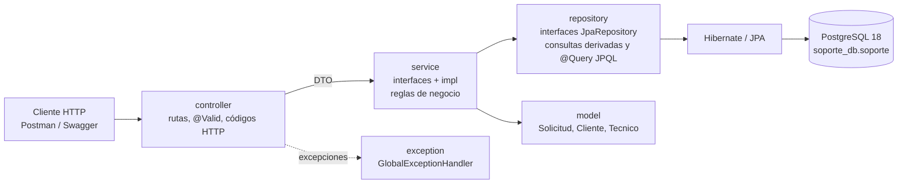
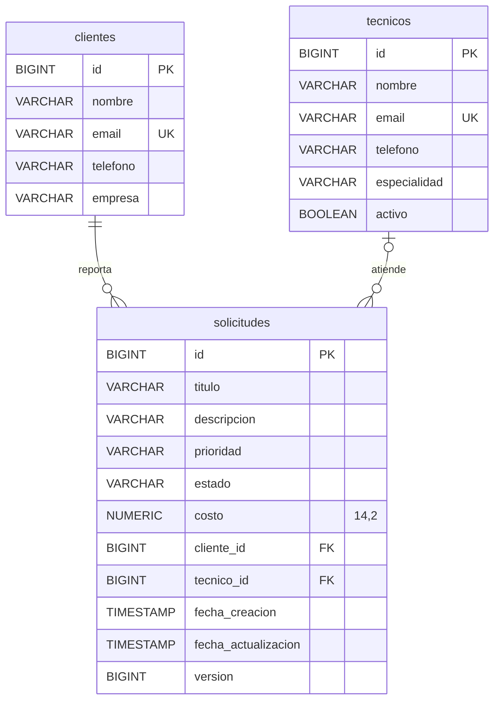
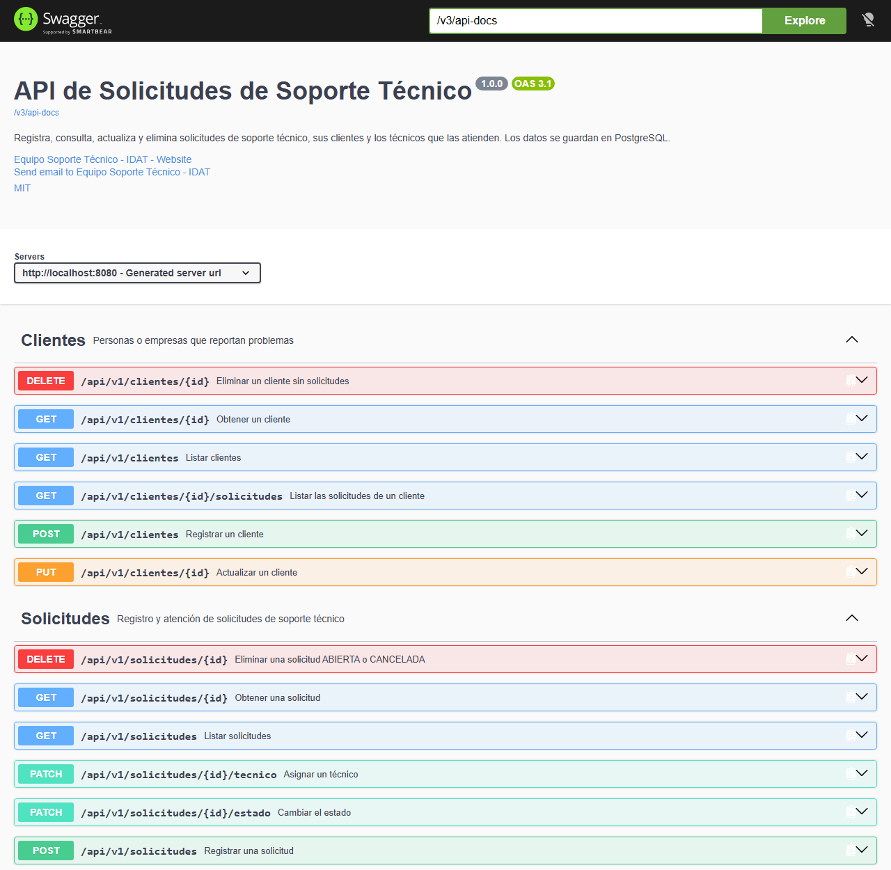
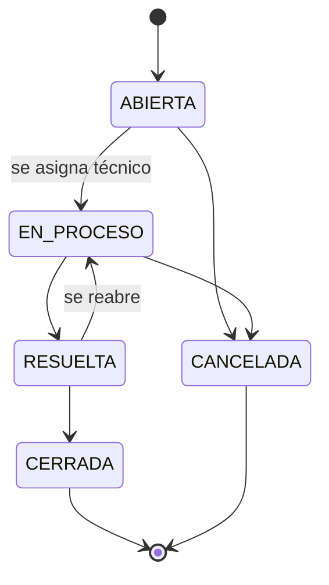

# API de Solicitudes de Soporte Técnico

API RESTful en Java y Spring Boot para que una empresa de servicios tecnológicos registre, consulte, actualice y elimine las solicitudes de soporte técnico de sus clientes, y asigne técnicos para atenderlas.

Proyecto del curso **Desarrollo de los Componentes del Negocio** (IDAT). Los datos se guardan en **PostgreSQL** con JPA, Hibernate y Spring Data JPA.

## Problema que resuelve

Hoy las solicitudes llegan en papel o por correos desordenados: se pierde información y la atención se retrasa. La API centraliza cada solicitud con su cliente, su prioridad, el técnico asignado y el estado de la atención, y aplica las reglas del negocio para que ninguna solicitud se cierre sin ser atendida ni se pierda el historial.

## Stack

| Componente | Versión |
|---|---|
| Java | 21 |
| Spring Boot (Web, Validation, Data JPA) | 4.1.1 |
| Hibernate (proveedor de JPA) | 7.4 |
| PostgreSQL | 18 |
| Lombok | 1.18 |
| Swagger UI (springdoc-openapi) | 3.1.1 |
| Maven (incluido con `mvnw`) | 3.9 |
| Pruebas | Postman |

Los datos quedan guardados en la base `soporte_db` (esquema `soporte`) y se conservan al reiniciar la aplicación.

## Arquitectura



```
src/main/java/pe/idat/soporte
├── config/        Swagger
├── controller/    recibe las peticiones y valida con @Valid
├── dto/           datos de entrada y salida (records)
├── exception/     manejo de errores con un formato único
├── mapper/        convierte entidades a DTO
├── model/         entidades JPA (@Entity): Persona, Cliente, Tecnico, Solicitud y enums
├── repository/    interfaces de Spring Data JPA
└── service/       reglas del negocio y transacciones (interfaces y service/impl)
src/test/java/...  pruebas de modelo, repositorio, servicio y API
database/          scripts SQL: base, esquema, tablas y datos de ejemplo
postman/           colección de pruebas funcionales
docs/img/          capturas
```

## Base de datos



| Script | Qué hace |
|---|---|
| `database/01_crear_base_de_datos.sql` | Crea la base `soporte_db` (una sola vez) |
| `database/02_crear_esquema_y_tablas.sql` | Crea el esquema `soporte`, las 3 tablas, llaves foráneas e índices |
| `database/03_datos_iniciales.sql` | Carga 2 clientes, 2 técnicos y 3 solicitudes de ejemplo |

Los scripts 02 y 03 se pueden ejecutar varias veces: solo crean lo que falta y no duplican datos. La aplicación los ejecuta sola al arrancar, y Hibernate (`ddl-auto=validate`) comprueba que las tablas coincidan con las entidades.

### Persistencia con JPA

- `@Entity` y `@Table` en cada entidad, `@Id` con `GenerationType.IDENTITY` y `@Column` con `nullable` y `length`.
- `@ManyToOne` de la solicitud hacia el cliente y el técnico.
- `BigDecimal` con `precision = 14, scale = 2` para el costo.
- Consultas derivadas (`findByEmailIgnoreCase`) y `@Query` con JPQL y `join fetch`.
- `@Transactional`: si una regla falla (`RuntimeException`), se hace rollback.
- `@Version`: bloqueo optimista; si dos peticiones modifican la misma solicitud a la vez, la segunda recibe **409**.

## Cómo ejecutarlo

Requisitos: **JDK 21**, **IntelliJ IDEA** y **PostgreSQL 18**. Maven no hace falta instalarlo: viene incluido en el proyecto.

1. Descargar el repositorio:
   ```bash
   git clone https://github.com/oropezadev-wq/soporte-tecnico-api.git
   ```
   o en GitHub: *Code → Download ZIP*.
2. Crear la base de datos, de una de estas dos formas:
   - **PostgreSQL instalado**: en pgAdmin, abrir el *Query Tool* sobre la base `postgres` y ejecutar `database/01_crear_base_de_datos.sql`.
   - **Docker**: `docker compose up -d` (levanta PostgreSQL 18 con la base `soporte_db` ya creada).
3. Revisar la conexión en `src/main/resources/application.properties`. Por defecto usa el usuario `postgres` con clave `postgres`; si la clave es otra, se cambia ahí o con las variables de entorno `DB_USUARIO` y `DB_CLAVE`:
   ```properties
   spring.datasource.url=jdbc:postgresql://localhost:5432/soporte_db?currentSchema=soporte
   spring.datasource.username=${DB_USUARIO:postgres}
   spring.datasource.password=${DB_CLAVE:postgres}
   ```
4. Abrir la carpeta en IntelliJ IDEA (*File → Open*) y esperar a que termine de cargar las dependencias.
5. Ejecutar la clase `SoporteTecnicoApiApplication` (botón *Run*).

Al arrancar se crean el esquema y las tablas, y se cargan los datos de ejemplo (2 clientes, 2 técnicos y 3 solicitudes).

- API: <http://localhost:8080/api/v1>
- Swagger UI: <http://localhost:8080/swagger-ui.html>



## Endpoints

Base: `/api/v1`

| Método | Ruta | Descripción | Respuestas |
|---|---|---|---|
| POST | `/clientes` | Registrar un cliente | 201, 400, 409 |
| GET | `/clientes` | Listar clientes | 200 |
| GET | `/clientes/{id}` | Obtener un cliente | 200, 404 |
| GET | `/clientes/{id}/solicitudes` | Solicitudes de un cliente | 200, 404 |
| PUT | `/clientes/{id}` | Actualizar un cliente | 200, 400, 404, 409 |
| DELETE | `/clientes/{id}` | Eliminar un cliente sin solicitudes | 204, 404, 409 |
| POST | `/tecnicos` | Registrar un técnico | 201, 400, 409 |
| GET | `/tecnicos?especialidad=REDES` | Listar técnicos (filtro opcional) | 200, 400 |
| GET | `/tecnicos/{id}` | Obtener un técnico | 200, 404 |
| GET | `/tecnicos/{id}/solicitudes` | Solicitudes asignadas a un técnico | 200, 404 |
| PUT | `/tecnicos/{id}` | Actualizar un técnico | 200, 400, 404, 409 |
| DELETE | `/tecnicos/{id}` | Eliminar un técnico sin solicitudes | 204, 404, 409 |
| POST | `/solicitudes` | Registrar una solicitud | 201, 400, 404 |
| GET | `/solicitudes?estado=ABIERTA&prioridad=ALTA` | Listar solicitudes (filtros opcionales) | 200, 400 |
| GET | `/solicitudes/{id}` | Obtener una solicitud | 200, 404 |
| PUT | `/solicitudes/{id}` | Actualizar título, descripción, prioridad y costo | 200, 400, 404, 409 |
| PATCH | `/solicitudes/{id}/tecnico` | Asignar un técnico | 200, 400, 404, 409 |
| PATCH | `/solicitudes/{id}/estado` | Cambiar el estado | 200, 400, 404, 409 |
| DELETE | `/solicitudes/{id}` | Eliminar una solicitud ABIERTA o CANCELADA | 204, 404, 409 |

### Reglas del negocio



- Toda solicitud empieza **ABIERTA** y pasa a **EN_PROCESO** al asignarle un técnico; no se pueden saltar estados.
- Una solicitud CERRADA o CANCELADA ya no se modifica, y solo se eliminan las ABIERTAS o CANCELADAS.
- El email de clientes y técnicos es único, y no se elimina a quien tenga solicitudes.

Los errores responden **400** (datos inválidos), **404** (no existe) o **409** (rompe una regla del negocio, o el registro cambió mientras se editaba).

### Ejemplos de uso

Se pueden probar desde Swagger UI o Postman.

**1. Registrar una solicitud**: `POST /api/v1/solicitudes`

```json
{
  "titulo": "La impresora no imprime",
  "descripcion": "Muestra papel atascado con la bandeja vacía",
  "prioridad": "ALTA",
  "costo": 80.00,
  "clienteId": 1
}
```

El `costo` es opcional. Respuesta **201 Created**: la solicitud queda `ABIERTA` y sin técnico.

```json
{
  "id": 4,
  "titulo": "La impresora no imprime",
  "prioridad": "ALTA",
  "estado": "ABIERTA",
  "costo": 80.00,
  "clienteId": 1,
  "clienteNombre": "María Quispe",
  "tecnicoId": null
}
```

**2. Asignar un técnico**: `PATCH /api/v1/solicitudes/4/tecnico` con `{ "tecnicoId": 1 }` → **200 OK** y el estado pasa a `EN_PROCESO`.

**3. Cambiar el estado**: `PATCH /api/v1/solicitudes/4/estado` con `{ "estado": "RESUELTA" }` → **200 OK**.

**4. Error de regla del negocio**: pedir `{ "estado": "CERRADA" }` a una solicitud `ABIERTA` → **409 Conflict**, porque no se pueden saltar estados.

**5. Error de validación**: `POST /api/v1/clientes` con el nombre vacío y un email sin `@` → **400 Bad Request** con el mensaje de cada campo:

```json
{
  "estado": 400,
  "error": "Bad Request",
  "mensaje": "Hay datos inválidos en la solicitud",
  "errores": {
    "nombre": "El nombre es obligatorio",
    "email": "El email no tiene un formato válido"
  }
}
```

## Pruebas con Postman

Importar `postman/soporte-tecnico-api.postman_collection.json` en Postman y ejecutarla con el **Runner** con la API levantada. Son 28 peticiones con 48 tests, en orden: cada petición guarda los ids que usan las siguientes. Cada corrida usa correos nuevos, así que se puede repetir sin vaciar la base.

Las pruebas automáticas (`./mvnw test`) usan otra base, `soporte_test`, que debe existir en el mismo PostgreSQL; su esquema se recrea en cada corrida.

## Equipo

| Apellidos | Nombres | Rol |
|---|---|---|
| Lopez Marmanillo | Abraham Sebastiam | Capa de presentación: controladores REST, validaciones de entrada y Swagger |
| Oropeza Ávila | Wali Jhonatan | Líder del proyecto y capa de negocio: servicios, reglas y manejo de excepciones |
| Pascual Cárdenas | Rony Emerzon | Capa de datos: entidades JPA, repositorios, scripts SQL y pruebas con Postman |
